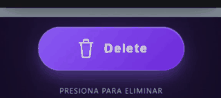

# 01 - Animated Delete Button 🗑️

A playful and delightful delete button with a micro-interaction where each letter flies into the trash bin one by one with a shake effect and audio/haptic feedback.

<p align="center">
  
</p>

---

## 📦 What's Included:
- **`web/`**: Pure HTML5, modern CSS3 animations (CSS variables), SVG, and Vanilla JavaScript with Web Audio API sound effect.
- **`android/`**: Jetpack Compose implementation in Kotlin using `Animatable`, `graphicsLayer`, and Haptic Feedback.

---

## 🚀 Web Usage
Simply open `web/index.html` in any browser or embed it in your web app:
```html
<button class="delete-btn" id="deleteBtn">
  <!-- Trash SVG -->
  <!-- Letters with --fly-dist -->
</button>
```

---

## 📱 Android (Jetpack Compose) Usage
Copy `AnimatedDeleteButton.kt` into your Compose project:
```kotlin
AnimatedDeleteButton(
    onDeleteComplete = {
        // Handle deletion logic
    }
)
```
